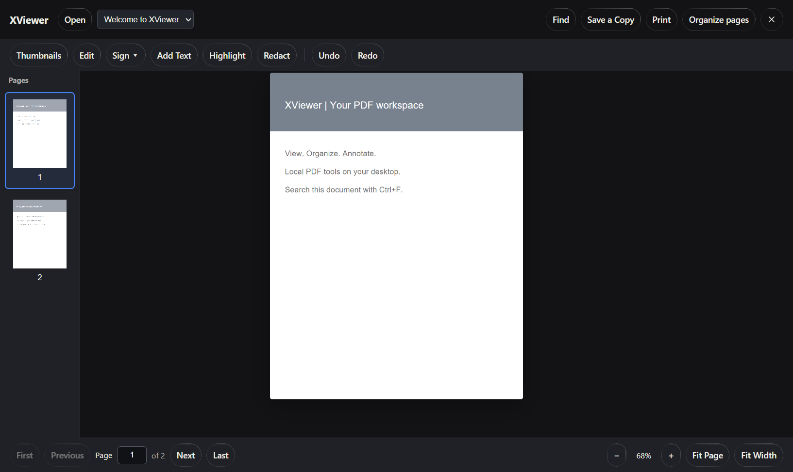

# XViewer

A local Windows desktop workspace for viewing, organizing, annotating, and searching PDFs.

Built on [PDFx](https://github.com/AlexandrosGounis/pdfx) by Alex Gounis. XViewer preserves the upstream MIT license and Git history. The rendering, canvas, markup, OCR, and redaction engines are inherited. The reader interface, navigation, image signatures, printing, Windows packaging, export corrections, and regression coverage are XViewer contributions.

## Getting started

Download the Windows setup executable from [Releases](https://github.com/imguru18695/XViewer/releases). Install and launch XViewer, then choose **Open documents** or drag PDFs into the window. Use **Ctrl+O** to open and **Ctrl+F** to search. In File Explorer choose **Open with → XViewer**. Windows Default apps lets you select it as your preferred PDF application.

Opening a PDF starts in the reader. Use **Page Up/Page Down**, **Home/End**, the page-number box, or thumbnails to navigate. **Fit Page**, **Fit Width**, and zoom controls are in the bottom bar. Select text to copy it. Search with **Ctrl+F**, then **Enter/Shift+Enter** to move between matching pages.

Choose **Sign → Draw signature** or **Sign → Choose signature image…** (PNG, JPEG, WebP). Drag an image to place it, use its blue corner to resize proportionally, and use the image options to replace or delete it. Undo/redo applies to image edits. Choose **Save a Copy** (**Ctrl+S**) to save the current document, or **Print** (**Ctrl+P**) for the system printer dialog, including current edits.

Choose **Organize pages** for the canvas and **Export PDF** to combine documents. Source files are not automatically overwritten. Save/export before closing: the workspace does not autosave.



## Features and limits

| Feature | Behavior |
| --- | --- |
| Read and navigate | Page keys, first/last, page-number entry, thumbnails, zoom and fit controls, text selection |
| Search | Text/OCR search with next/previous matching-page navigation |
| Organize | Reorder, move, remove pages; export combined PDF or documents as ZIP |
| Annotate | Highlights, freehand drawing, added text |
| Image signatures | Choose a local image, move, resize, replace, delete, undo/redo; embedded in saved PDFs |
| Print | System printer dialog for the current document including edits; 150-DPI page rendering, up to 500 pages / 256 MB per job |
| Forms | Existing text fields and checkboxes; filled fields may be flattened |
| OCR | Local scanned-page search; bundled English, German, French, Spanish assets |
| Redaction | Content removal on export, with raster fallback for unsupported content |
| Windows integration | Installer, PDF/PDFX associations, single-instance file opening |

OCR search does **not** currently add a persistent text layer to exported scans. Redaction has basic regression coverage; complex documents need validation before confidential use. Drawn and image signatures are visual marks, not certificate signatures. Image editing covers placement, size, replacement, and deletion; cropping and background removal are not included. Existing paragraph editing, Office conversion, PDF/A, and password management are outside this release.

PDF processing and OCR run locally. The inherited optional AI assistant requires provider configuration and sends document context to that provider when used. Core tools require no API key. Never commit keys.

## Development

Requires Node.js 22 or 24 and npm on Windows.

```powershell
npm ci
npm run dev
npm test
npm run build:win
```

Installers appear in `dist/`. After `npm run build`, run `npm run smoke` to launch Electron with a generated PDF and capture screenshots.

## XViewer contributions

- Separate Windows app identity, per-user installer, and PDF associations.
- Reader-first interface with keyboard navigation, page thumbnails, fit controls, and text selection.
- Local signature-image editing and PDF embedding, with undo/redo.
- Native print-dialog integration using the edited PDF, with isolated print rendering.
- Buffer file requests received while the renderer starts.
- Plain PDF exports omit collection manifests and original document names.
- Failed form filling stops export rather than silently saving unfilled content.
- Regression tests, desktop smoke checks, Windows CI, and release automation.

See [architecture](docs/ARCHITECTURE.md), [validation](docs/VALIDATION.md), and [roadmap](docs/ROADMAP.md). This is an early derivative project; the list above distinguishes our changes from inherited functionality.

## License

MIT. Upstream copyright remains with Alex Gounis; see [LICENSE](LICENSE) and [NOTICE](NOTICE). Dependencies retain their own licenses.
