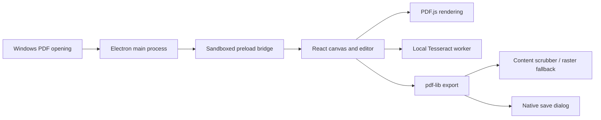

# Architecture

XViewer uses Electron, React, and TypeScript.

The main process owns dialogs, file I/O, and file-open events. Requests are buffered until renderer readiness; subsequent launches forward files to the existing instance.

Sources are separate from document/page order, marks, form values, and added elements. Export assembles a new document. Only PDFX collection exports embed a manifest of document names and page counts. Plain PDFs omit it.

Forms are filled before assembly; field/source failures abort export. Redaction attempts content-stream rewriting and falls back to rasterization. Tests inspect exported content rather than only visual overlays.

OCR runs in a worker with bundled language assets. Search indexes are in memory. Persistent OCR export and workspace recovery remain future work. Internal PDFX IPC and format names remain for compatibility; XViewer has its own application identity.
