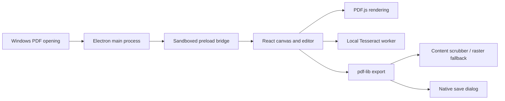

# Architecture

XViewer uses Electron, React, and TypeScript.

The main process owns dialogs, file I/O, and file-open events. Requests are buffered until renderer readiness; subsequent launches forward files to the existing instance.

Sources are separate from document/page order, marks, form values, and added elements. Export assembles a new document. Only PDFX collection exports embed a manifest of document names and page counts. Plain PDFs omit it.

Forms are filled before assembly; field/source failures abort export. Redaction attempts content-stream rewriting and falls back to rasterization. Tests inspect exported content rather than only visual overlays.

OCR runs in a worker with bundled language assets. Search indexes are in memory. Persistent OCR export and workspace recovery remain future work. Internal PDFX IPC and format names remain for compatibility; XViewer has its own application identity.

The reader uses the existing page renderer with navigation controls and a thumbnail rail. Page keys work at any zoom level; text input retains normal keyboard behavior. The canvas remains a separate organization view.

Image signatures are stored as normalized PNG assets with page-relative bounding boxes. Pointer dragging and aspect-preserving resizing update element state through the undo stack. PDF export embeds the image with crop-box and source-page rotation transforms.

Printing builds the edited PDF through the normal export pipeline, renders its pages at 150 DPI, and sends PNG page data through a narrow IPC method. The main process validates payloads and constructs an isolated print-only window with a restrictive CSP. Native printing uses `silent: false`, so the user chooses printer settings. The print window is destroyed after completion or cancellation.
